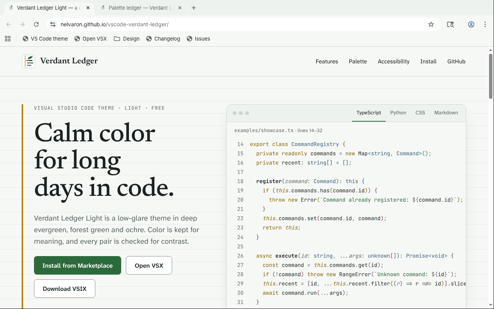
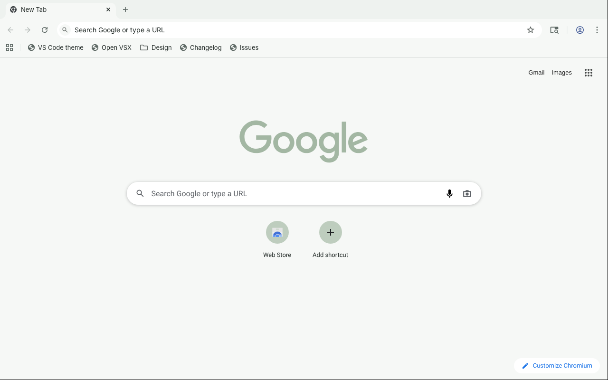

# Verdant Ledger Light for Chrome and Edge

A calm, low-glare light theme for Google Chrome, Microsoft Edge, and other
Chromium browsers. Soft green-tinted surfaces and deep evergreen text keep the
browser quiet around the page, in the same colors as
[Verdant Ledger Light for VS Code](https://github.com/nelvaron/vscode-verdant-ledger).

**Install:** [Chrome Web Store](https://chromewebstore.google.com/detail/kpbfkockcbnoncanamgcnbfkiffannln)

## Highlights

- **Calm by design.** Two near-white surfaces, deep evergreen text, and
  evergreen gray for icons and background tabs. Forest green is kept for
  links on the New Tab page; the Google logo there turns a quiet sage.
- **Readable for everyone.** Tab titles, bookmarks, the address bar, and New
  Tab page text meet WCAG AA contrast (4.5:1); toolbar icons reach 5.42:1.
- **Complete.** Every color Chromium takes from a theme is set, so the
  browser never fills one in with its own default.
- **Matches the editor.** The colors and their names come from the VS Code
  theme: the frame is the editor's sidebar, the active tab and toolbar are
  the editor background.
- **Checked automatically.** Every change is validated for contrast, palette
  use, and theme keys that Chromium reads.

## Install

**Google Chrome:** open the theme in the
[Chrome Web Store](https://chromewebstore.google.com/detail/kpbfkockcbnoncanamgcnbfkiffannln) and select **Add to Chrome**.

**Microsoft Edge:** open the same [Chrome Web Store page](https://chromewebstore.google.com/detail/kpbfkockcbnoncanamgcnbfkiffannln), select **Allow
extensions from other stores** in the banner at the top, then **Add to
Chrome**. Edge applies Chrome themes as they are.

**Brave and other Chromium browsers** that support Chrome Web Store themes
install it the same way.

To remove the theme, open **Settings** > **Appearance** and select **Reset to
default** (in Edge, choose another theme).

### Install from this repository

1. Download `verdant-ledger-light-<version>.zip` from the
   [latest release](https://github.com/nelvaron/chromium-verdant-ledger/releases/latest)
   and unzip it, or clone the repository and use the `theme` folder.
2. Open `chrome://extensions` (in Edge, `edge://extensions`) and turn on
   **Developer mode**.
3. Select **Load unpacked** and choose the folder that contains
   `manifest.json`.

## Color palette

The browser uses six of the colors of the VS Code theme:

| Color | Name | Used for |
| --- | --- | --- |
| `#1b2320` | Deep evergreen | Tab titles, bookmarks, address bar and New Tab page text |
| `#5d6864` | Evergreen gray | Background tab titles, toolbar icons, New Tab page section borders |
| `#2d6a3b` | Forest green | Links on the New Tab page |
| `#eef2ef` | Pale surface | Window frame and background tabs |
| `#f6f8f6` | Near-white surface | Active tab, toolbar, bookmarks bar, New Tab page |
| `#ffffff` | White | Address bar |

[DESIGN.md](DESIGN.md) lists every theme color Chromium reads, where it
appears, and the parts of the browser a theme cannot change.

## Accessibility

| Text or icon | Background | Contrast |
| --- | --- | ---: |
| Active tab title | Active tab | 15.04:1 |
| Active tab title, window in the background | Active tab | 6.81:1 |
| Background tab titles | Frame | 5.12:1 |
| Bookmarks | Bookmarks bar | 15.04:1 |
| Toolbar icons | Toolbar | 5.42:1 |
| Address bar text | Address bar | 16.06:1 |
| New Tab page text | New Tab page | 15.04:1 |
| New Tab page links | New Tab page | 6.08:1 |

Chromium draws the title of the active tab 25% lighter when the window is in
the background, and the theme keeps it above 4.5:1.

## Good to know

- **Incognito and InPrivate windows** keep the browser's dark look. Chromium
  does not apply themes to them, which also keeps them easy to tell apart.
- **Menus, dialogs, and side panels** follow the browser's light or dark mode,
  and buttons and links in them keep the browser's accent blue; a theme
  cannot change either. To match the theme, set the mode to **Light** in
  **Customize Chrome** > **Appearance**.
- **Web pages** are not changed. The theme colors the browser around them.

## Contributing

Bug reports and suggestions are welcome in the
[issue tracker](https://github.com/nelvaron/chromium-verdant-ledger/issues).
[CONTRIBUTING.md](CONTRIBUTING.md) explains how to preview, validate,
package, and publish the theme.

## Privacy

The theme contains only colors and icons. It has no code, needs no
permissions, and collects no data. See [PRIVACY.md](PRIVACY.md).

## License

[MIT](LICENSE)
